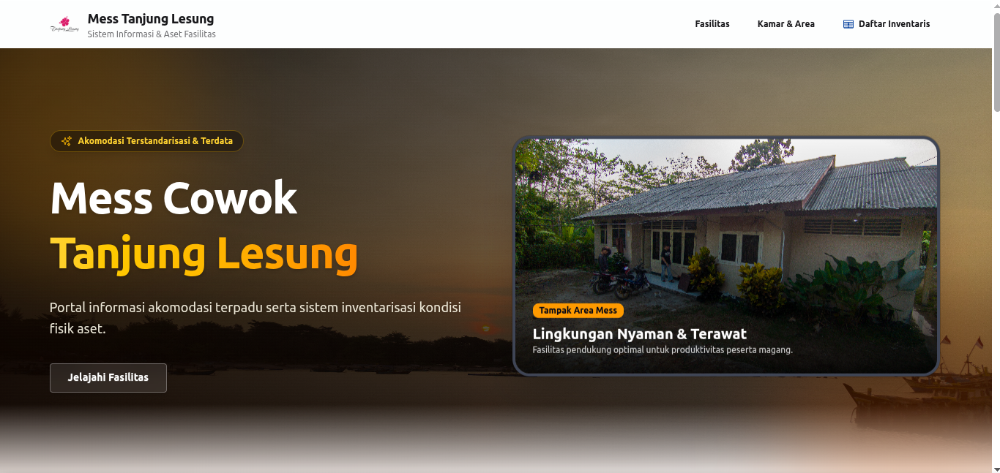
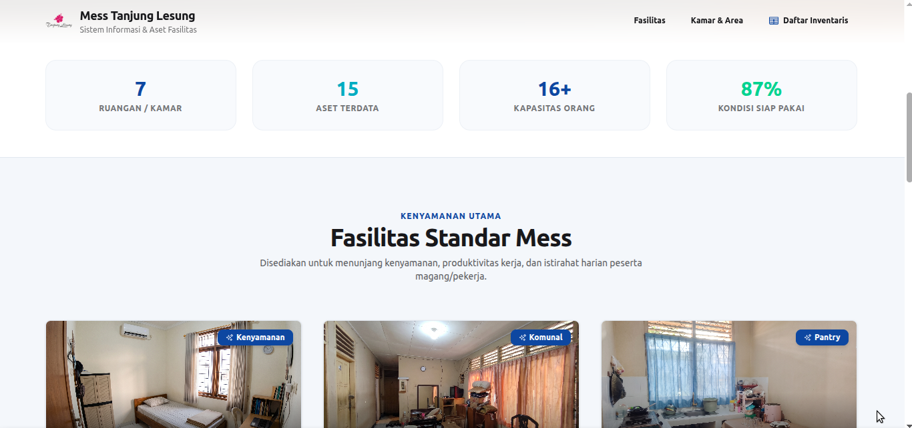
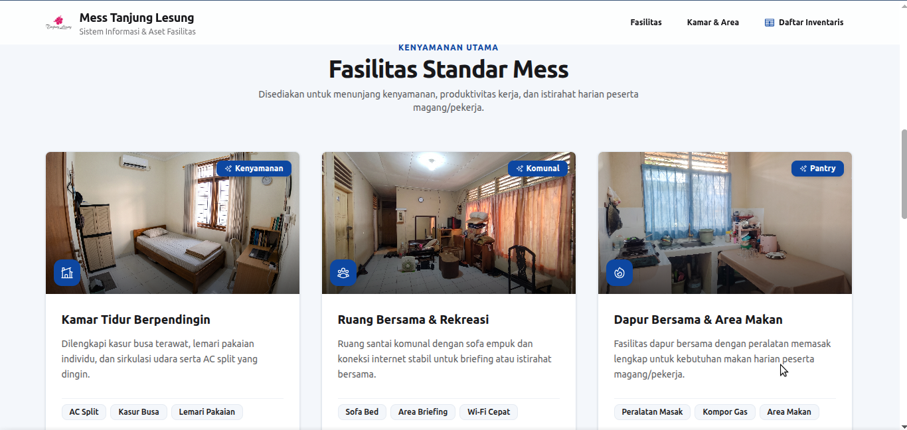
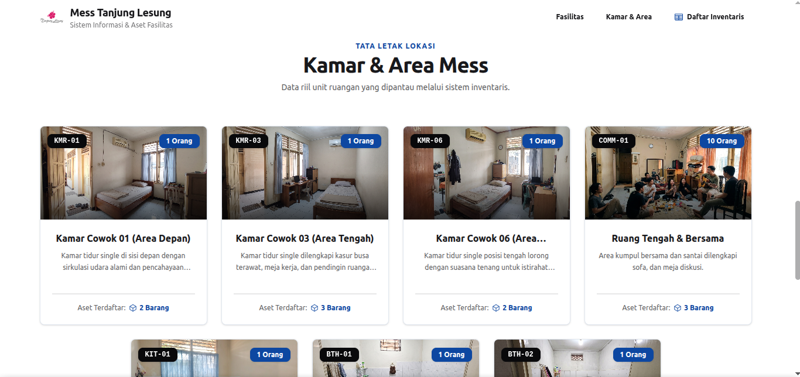
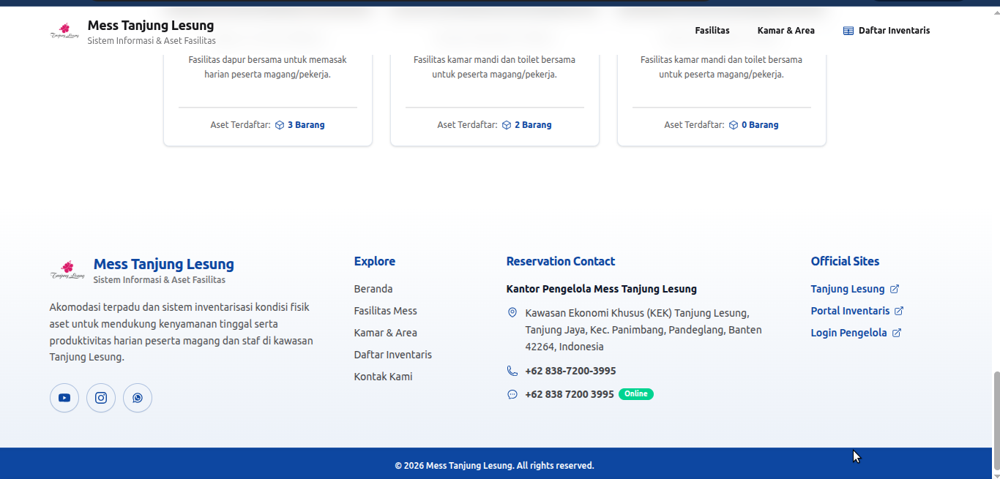
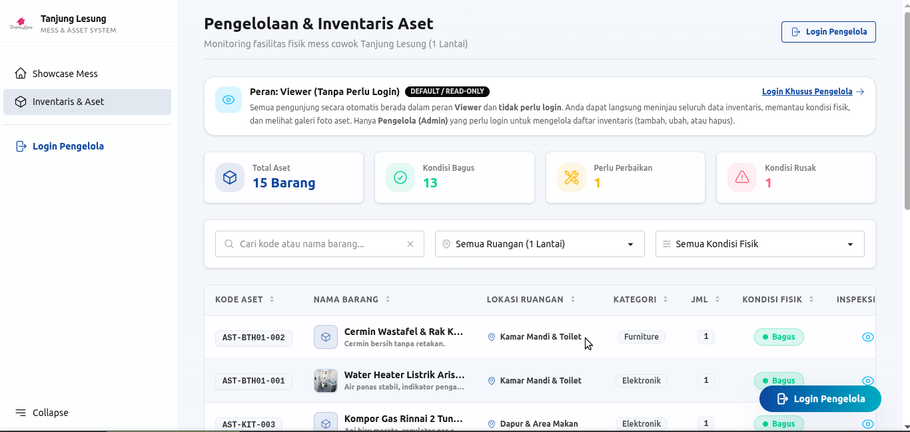
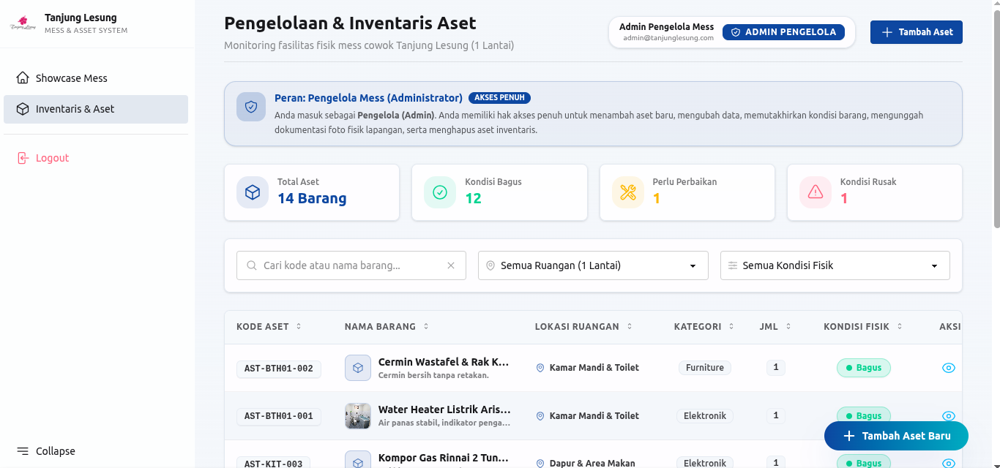
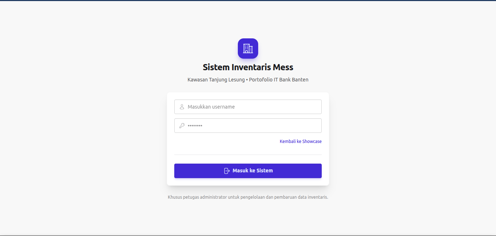

# Sistem Informasi Showcase Mess & Inventarisasi Aset - Tanjung Lesung

Sistem web modern berbasis **Laravel 12**, **Livewire 4**, dan **Mary UI (DaisyUI 5 + Tailwind CSS v4)** untuk menampilkan akomodasi mess karyawan/peserta magang di Tanjung Lesung serta tata kelola inventarisasi aset fisik dengan standar keamanan dan otorisasi *Role-Based Access Control* (RBAC).

---

## 🌟 Fitur Utama

### 1. Showcase Akomodasi Mess (Landing Page)
- **Hero Banner Sinematik**: Latar pemandangan *sunset golden hour* pesisir Tanjung Lesung dengan tipografi kontras tinggi yang nyaman dibaca.

### 2. Pengelolaan Inventaris Aset (Livewire 4 SPA)
- **Tabel Responsif & Proporsional**:
  - Penomoran kode aset monospace (`AST-KMR01-001`).
  - Thumbnail gambar fisik asli pada barang yang memiliki dokumentasi foto.
  - Pemotongan teks otomatis dengan elipsis (`...`) pada deskripsi dan nama ruangan agar tabel rapi dan tidak memicu bilah gulir horizontal (*no unnecessary scrollbar*).
  - Tooltip *hover* untuk membaca deskripsi lengkap.
- **Filter & Pencarian Multikriteria**:
  - Pencarian instan (debounce) berdasarkan kode atau nama barang.
  - Filter lokasi per ruangan master.
  - Filter status kondisi fisik (*Bagus*, *Perlu Perbaikan*, *Rusak*).
- **Inspeksi & Galeri Foto Lapangan (Modal Detail)**:
  - Galeri foto dokumentasi fisik resolusi tinggi beserta catatan kondisi dan identitas pengunggah (*Audit Trail*).
- **Paginasi Bebas Tabrakan (*Safe-Area Pagination*)**:
  - Tata letak paginasi diatur dengan jarak aman agar tombol navigasi nomor halaman tidak tertimpa oleh *Floating Action Button*.
  - Tombol aksi ganda: Administrator dapat menambah aset melalui *Header Action* di bagian atas maupun *Floating Button* di sudut kanan bawah.

### 3. Arsitektur Data Ruangan
- Data master **7 Ruangan Mess** dan **Fasilitas** diakses langsung melalui model in-memory (`App\Models\Room` dan `App\Models\Facility`), sehingga sangat cepat dan bebas dari kueri tabel database yang berulang.
- Database relasional murni dikhususkan untuk **Akun Pengguna (`users`)**, **Data Inventaris Aset (`assets`)**, dan **Dokumentasi Foto Fisik (`asset_photos`)**.

---

## 📸 Tangkapan Layar Sistem (Screenshots)

Berikut dokumentasi antarmuka aplikasi Sistem Informasi Showcase Mess & Inventarisasi Aset:

### 1. Showcase Akomodasi Mess (Landing Page)
| Hero Banner Sinematik | Ringkasan Metrik & Fasilitas |
| :---: | :---: |
|  |  |

| Detail Fasilitas Standar Mess | Tata Letak Kamar & Area Mess |
| :---: | :---: |
|  |  |

| Footer Resmi & Informasi Kontak Pengelola |
| :---: |
|  |

### 2. Pengelolaan Inventaris Aset & Autentikasi
| Mode Viewer (Publik / Tanpa Login) | Mode Pengelola / Admin (Akses Penuh) |
| :---: | :---: |
|  |  |

| Halaman Login Administrator |
| :---: |
|  |

---

## 🛏️ Daftar Data Master Ruangan Mess

| Kode Ruangan | Nama Ruangan / Area | Kapasitas | Foto Cover |
| :--- | :--- | :---: | :--- |
| `KMR-01` | Kamar Cowok 01 (Area Depan) | 1 Orang | `/images/kamar-depan.jpeg` |
| `KMR-03` | Kamar Cowok 03 (Area Tengah) | 1 Orang | `/images/kamar-tengah.jpeg` |
| `KMR-06` | Kamar Cowok 06 (Area Belakang) | 1 Orang | `/images/kamar-belakang.jpeg` |
| `COMM-01` | Ruang Tengah & Bersama | 10 Orang | `/images/kumpul.jpeg` |
| `KIT-01` | Dapur & Area Makan | 1 Orang | `/images/masak-masak.jpeg` |
| `BTH-01` | Kamar Mandi & Toilet Depan | 1 Orang | `/images/mandi-depan.jpeg` |
| `BTH-02` | Kamar Mandi & Toilet Belakang | 1 Orang | `/images/mandi-belakang.jpeg` |

---

## 👥 Hak Akses & Tata Kelola Pengguna

Sistem dirancang dengan prinsip kemudahan akses informasi dan keamanan bertingkat:

> [!IMPORTANT]
> ### 🔑 Kredensial Default Login Pengelola (Admin)
> - **URL Login:** `http://localhost:8000/login`
> - **Username:** `admin`
> - **Password:** `password`
> 
> Akun administrator ini secara otomatis dibuat saat menjalankan database seeder (`php artisan migrate:fresh --seed`) untuk keperluan pengelolaan penuh aset inventaris.

1. **Viewer (Default - Seluruh Pengunjung / Tanpa Perlu Login)**
   - Semua orang yang membuka aplikasi secara otomatis bertindak sebagai **Viewer**.
   - **Tidak perlu login sama sekali**.
   - Hak akses: Menjelajahi *landing page showcase*, membuka katalog daftar inventaris mess, melakukan pencarian & filter data, mengecek status kondisi barang, serta membuka galeri foto fisik lapangan dalam mode baca (*Read-Only*).

2. **Pengelola / Admin (Khusus Petugas - Memerlukan Login)**
   - Satu-satunya pihak yang **wajib melakukan login**.
   - Hak akses penuh: Mengelola daftar inventaris (menambah aset baru, memperbarui informasi & kondisi fisik barang, mengunggah dokumentasi foto lapangan, dan menghapus aset).
   - **Kredensial Login Pengelola:**
     - **Username:** `admin`
     - **Password:** `password`

| Peran (Role) | Akses Login | Hak Akses Utama |
| :--- | :--- | :--- |
| **Viewer (Default)** | **Tanpa Login** (Akses Langsung) | Peninjauan inventaris, cek status barang, filter ruangan, galeri foto fisik (*Read-Only*) |
| **Pengelola / Admin (`admin`)** | **Wajib Login** (`admin` / `password`) | Hak akses penuh: Tambah, edit, hapus aset inventaris, upload foto fisik lapangan |

---

## 🛠️ Tumpukan Teknologi (Tech Stack)

- **Backend**: PHP 8.3+, [Laravel 12](https://laravel.com)
- **Reaktivitas UI**: [Livewire 4](https://livewire.laravel.com), [Mary UI 2.9](https://mary-ui.com)
- **Styling & Tema**: [Tailwind CSS v4](https://tailwindcss.com), [DaisyUI 5](https://daisyui.com)
- **Database**: PostgreSQL (atau SQLite / MySQL sesuai konfigurasi lingkungan)
- **Frontend Bundler**: [Vite 8](https://vitejs.dev)
- **Pengujian & Standar Kode**: PHPUnit 12, Laravel Pint

---

## 🚀 Panduan Instalasi & Menjalankan Aplikasi

### 1. Kloning Repositori
```bash
git clone <url-repositori-anda>
cd tl-mess-inventory
```

### 2. Jalankan PostgreSQL dengan Docker
Jika Anda belum memiliki PostgreSQL lokal, Anda dapat menjalankannya dengan mudah menggunakan Docker:

```bash
# Jalankan container PostgreSQL
docker run --name postgres-db -e POSTGRES_USER=papermint -e POSTGRES_PASSWORD='password_anda' -e POSTGRES_DB=mess_db -p 5432:5432 -d postgres:latest
```

*Jika container PostgreSQL sudah ada, pastikan database `mess_db` sudah dibuat:*
```bash
docker exec -it postgres-db psql -U papermint -d postgres -c "CREATE DATABASE mess_db;"
```

### 3. Instalasi Dependensi PHP & JavaScript
```bash
composer install
npm install
```

### 4. Konfigurasi Lingkungan (.env) & Generate App Key
Salin berkas contoh lingkungan dan **wajib** generate application encryption key:
```bash
cp .env.example .env
php artisan key:generate
```

Sesuaikan parameter koneksi database pada `.env` agar terhubung ke container Docker:
```env
DB_CONNECTION=pgsql
DB_HOST=127.0.0.1
DB_PORT=5432
DB_DATABASE=mess_db
DB_USERNAME=nama_user_anda
DB_PASSWORD=password_anda
```

> [!TIP]
> Jika password database mengandung karakter khusus (seperti `$`, `&`, atau `#`), pastikan nilai `DB_PASSWORD` diapit oleh tanda petik tunggal (`'...'`) di file `.env`.

### 5. Tautkan Storage Simbolik
Pastikan folder berkas publik tertaut ke storage penyimpanan foto fisik aset:
```bash
php artisan storage:link
```

### 6. Jalankan Migrasi & Database Seeder
Jalankan migrasi bersih beserta data mock inventaris dan akun pengelola:
```bash
php artisan migrate:fresh --seed
```
*Catatan: Perintah seeder otomatis membuat akun administrator (`admin` / `password`) dan viewer (`viewer` / `password`).*

### 7. Kompilasi Aset Frontend
Untuk mode produksi:
```bash
npm run build
```

Untuk mode pengembangan aktif:
```bash
npm run dev
```

### 8. Jalankan Server Lokal
Jalankan server pengembangan dengan dukungan unggah foto fisik lapangan hingga 10MB:
```bash
composer run serve
# atau jalankan mode pengembangan lengkap (Laravel + Vite bersamaan):
composer run dev
# atau menggunakan artisan langsung:
php artisan serve
```

Akses aplikasi melalui peramban:
- **Showcase & Katalog Inventaris (Mode Viewer):** `http://localhost:8000`
- **Login Administrator:** `http://localhost:8000/login` *(Gunakan username: `admin` & password: `password`)*

---

## 🛠️ Catatan Pemecahan Masalah (Troubleshooting)

- **`No application encryption key has been specified` (MissingAppKeyException):**
  Jalankan perintah `php artisan key:generate` lalu refresh browser Anda.
- **`Vite manifest not found`:**
  Jalankan `npm install` kemudian `npm run build` atau jalankan `npm run dev`.
- **Foto aset tidak muncul (404 Not Found):**
  Pastikan symlink storage sudah aktif dengan menjalankan `php artisan storage:link`.
- **Koneksi Database Gagal (Connection Refused):**
  Pastikan container Docker PostgreSQL sedang berjalan dengan mengecek `docker ps`. Jika belum jalan, hidupkan dengan `docker start postgres-db`.

## 🧪 Pengujian & Kualitas Kode

Jalankan seluruh rangkaian pengujian fitur dan unit:
```bash
php artisan test
```

Pastikan format kode memenuhi standar PSR-12 dan gaya Laravel:
```bash
vendor/bin/pint --format agent
```

---